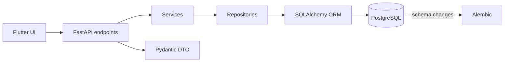

<div align="center">
  
  <h1>Кадровое агентство</h1>
  <p>Мобильное приложение и REST API для управления вакансиями, кандидатами и наймом</p>
  <p>
    
    
    
    <a href="https://github.com/SoD1Ox/Mobile-app/actions/workflows/android-apk.yml"></a>
  </p>
</div>

Приложение для кадрового агентства: сотрудники ведут вакансии и кандидатов, а отклики проходят по этапам найма. Интерфейс выполнен в едином стиле «жидкое стекло» и адаптирован для Android и компьютера.

## Возможности

| Раздел | Что можно делать |
| --- | --- |
| Авторизация | Регистрация, вход, JWT-сессия и роли пользователей |
| Вакансии | Поиск и фильтры по городу, формату и зарплате; сортировка; избранное; создание и редактирование |
| Кандидаты | Профили, контакты, отклики и заметки рекрутера |
| Компании | Карточки компаний и контактные лица |
| Воронка найма | Перемещение откликов между этапами, история статусов и назначение сотрудников |
| Главная | Приветствие, профиль и статистика найма с обновлением по жесту |

Демо-вакансии используют зарплатные вилки по должностям: от 55–95 тыс. ₽ для складских ролей до 150–300 тыс. ₽ для ряда инженерных специализаций. Зарплата указана за месяц.

## Архитектура



Клиентские DTO, Pydantic-схемы API и ORM-модели разделены. Все запросы к базе идут через SQLAlchemy-сессии. SQLite не используется.

## Технологии

- **Клиент:** Flutter / Dart, HTTP, SharedPreferences
- **API:** FastAPI, Pydantic, JWT, bcrypt
- **База данных:** PostgreSQL, SQLAlchemy 2, Alembic
- **Данные:** пагинация, поиск и фильтры на стороне API

## Быстрый запуск

Подробные инструкции для Windows и PowerShell находятся в [docs/GUIDE.md](docs/GUIDE.md).

### 1. API и PostgreSQL

```powershell
cd backend
Copy-Item .env.example .env
# В .env укажите PostgreSQL и задайте случайный SECRET_KEY длиной не менее 32 байт.
pip install -r requirements.txt
alembic upgrade head
python -m scripts.seed
uvicorn app.main:app --host 0.0.0.0 --port 8000
```

Документация API: [http://127.0.0.1:8000/docs](http://127.0.0.1:8000/docs)

### 2. Flutter

```powershell
cd ui
flutter pub get
flutter run -d edge
```

Демо-аккаунты после заполнения БД: `admin / admin123`, `manager / manager123`, `worker / worker123`.

### Android APK

Собрать APK для телефона в той же Wi-Fi-сети, что и компьютер с API:

```powershell
cd ui
flutter build apk --release --dart-define=API_BASE_URL=http://<IP-компьютера>:8000/api/v1
```

Файл появится в `ui/build/app/outputs/flutter-apk/app-release.apk`. Сервер API должен быть запущен на компьютере. Для Android-эмулятора можно использовать `http://10.0.2.2:8000/api/v1`. GitHub Actions также собирает APK для эмулятора: [запуски сборки](https://github.com/SoD1Ox/Mobile-app/actions/workflows/android-apk.yml).

## Роли и безопасность

| Роль | Доступ |
| --- | --- |
| Администратор | Все разделы и управление пользователями |
| Рекрутер | Вакансии, компании, кандидаты и общая воронка |
| Сотрудник | Вакансии и только назначенные ему отклики |

Пароли хранятся в виде bcrypt-хешей. API проверяет JWT и права роли на сервере. Для запуска задайте собственный `SECRET_KEY`; демо-пароли предназначены только для локальных данных.

## Документы

- [Гайд запуска и настройки](docs/GUIDE.md)
- [Vision](docs/pr1/Vision%202.0%20-%20допил.docx)
- [Software Architecture Document](docs/pr2/Software%20Architecture%20Document.docx)
